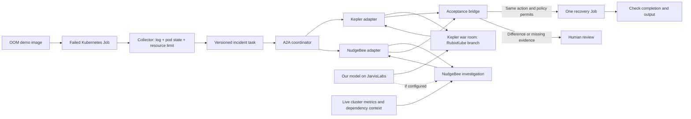

# MVP build plan: Docker OOM job, Kepler war room, NudgeBee, and acceptance bridge

This is an implementation plan, not a claim that the integrations are already running. The existing [project definition](PROJECT_PLAN.md) explains the broader product and judging story. This file fixes one demonstrable MVP path and its required deliverables.

## The MVP in one sentence

Run a deliberately memory-hungry Docker image as a Kubernetes Job; send the resulting log and container state to a Kepler war room and a NudgeBee investigation; compare their independent recommendations in an acceptance bridge; run one approved recovery Job with a higher memory limit; verify that it completes.

Running the image as a Kubernetes Job keeps the Docker image at the center of the demo while giving NudgeBee real workload and node context. NudgeBee documents a local KinD setup with inventory, events and metrics. Its local guide notes that eBPF tracing is unavailable there and rightsizing recommendations require about an hour of history, so the MVP relies on current events and metrics rather than a fresh rightsizing recommendation. [NudgeBee local setup](https://docs.nudgebee.com/docs/installation/agent/local-setup/)

## What the audience will see



The Kepler war room's subagents collaborate **within the RubixKube-side investigation**. NudgeBee remains the second external investigation branch. The bridge compares one final assessment from each branch, not every war-room subagent separately. Kepler advertises a war room where several agents work on one incident. [Kepler](https://trykepler.rubixkube.ai/)

## Lab prerequisites and first decisions

| Item | Needed for | Current fact or decision |
| --- | --- | --- |
| Docker | Build and rehearse the image; provide KinD's container runtime | Docker CLI is present in this workspace; daemon availability has not been checked |
| `kubectl` | Observe Jobs and pods | CLI is present |
| KinD | Disposable local Kubernetes cluster | CLI is not installed here yet |
| Helm | NudgeBee agent setup | CLI is not installed here yet |
| NudgeBee tenant and agent key | Live cluster data and investigation workflow | Must be supplied through the account; do not put the key in the repository |
| Kepler beta | War room and operator workspace | Must be installed and signed in |
| JarvisLabs instance/model | Real model inference | Need reachable endpoint and actual model ID |
| RubixKube tenant | Cloud investigation and custom tools if enabled | Custom REST/MCP integration is documented as Enterprise-only |
| Public HTTPS address for the bridge | NudgeBee cloud callback and external tool calls | Use a controlled hosted endpoint or HTTPS tunnel; protect callbacks with a token |

Allow enough memory for the local cluster and observability stack. NudgeBee's agent installation guide estimates roughly 5 GB RAM when its bundled observability components are included; the workload and KinD nodes need additional headroom. [NudgeBee agent requirements](https://docs.nudgebee.com/docs/installation/agent/installation/)

The team should decide at the start whether the Kepler war room is the RubixKube branch for this MVP or whether the RubixKube cloud agent will also run. The concrete baseline below uses **Kepler as the operator-driven RubixKube branch**. A cloud agent can be added if the tenant allows custom tools and a usable investigation interface. Kepler's public material does not establish a headless trigger/result API, so do not promise unattended Kepler execution without proving it in the supplied beta. [Kepler overview](https://rubixkube.ai/blog/kepler-a-tool-for-the-operator), [RubixKube integrations](https://docs.rubixkube.ai/using/integrations)

## File layout to build

```text
mvp/
  fixture/
    Dockerfile
    worker.py
  kubernetes/
    kind.yaml
    namespace.yaml
    job-oom.yaml
    job-recovery.yaml
  bridge/
    app.py                   # incident, evidence, assessment, decision, status API
    contracts.py             # exact task, assessment and action schemas
    comparator.py            # deterministic agreement and policy decision
    executor.py              # only permitted Kubernetes Job creation
    model_client.py          # JarvisLabs inference client
    store.py                 # SQLite incident and audit records
  adapters/
    kepler_submit.py         # local helper for the war-room result
    nudgebee_webhook.py      # dispatch and callback normalization
    a2a/                    # two A2A servers and coordinator client
  evidence/                  # generated log and metadata, ignored by Git
  demo.md                    # one-page runbook for the live demo
```

Do not commit API keys, agent auth keys, or generated incident logs that may contain secrets. The proposed paths are our code and API, not vendor API paths.

## The exact failure image

The image has one job: allocate and touch memory in small steps, print its progress, and print a completion marker only if it reaches its target. There is no application bug to debug; the failure is the container limit.

`mvp/fixture/Dockerfile`:

```dockerfile
FROM python:3.12-slim
WORKDIR /app
COPY worker.py /app/worker.py
ENV PYTHONUNBUFFERED=1 TARGET_MIB=192
USER 65532:65532
CMD ["python", "/app/worker.py"]
```

`mvp/fixture/worker.py`:

```python
import os
import time

target_mib = int(os.environ.get("TARGET_MIB", "192"))
blocks = []
while len(blocks) * 8 < target_mib:
    block = bytearray(8 * 1024 * 1024)
    for offset in range(0, len(block), 4096):
        block[offset] = 1
    blocks.append(block)
    print(f"allocated_mib={len(blocks) * 8}", flush=True)
    time.sleep(0.1)
print("RESULT: completed memory workload", flush=True)
```

Build the image once as `oom-lab:0.1`. Rehearse it under a 128 MiB Docker memory limit and retain the container so its state can be inspected. The expected failure is `OOMKilled=true`, often with exit code 137; inspect the actual state rather than diagnosing from the exit code or `.txt` log alone. Reuse the same image with a 384 MiB limit for recovery. The fixture must print the `RESULT` marker and exit 0 in that case. [Docker memory limits](https://docs.docker.com/engine/containers/resource_constraints/), [Docker exit status note](https://docs.docker.com/reference/cli/docker/container/ls)

The quick Docker-only rehearsal, before connecting any agent, is:

```sh
docker build -t oom-lab:0.1 mvp/fixture
docker run --name oom-lab-fail --memory=128m --memory-swap=128m -e TARGET_MIB=192 oom-lab:0.1
docker inspect oom-lab-fail --format '{{json .State}}'
docker logs oom-lab-fail > mvp/evidence/stdout.txt
docker run --rm --memory=384m --memory-swap=384m -e TARGET_MIB=192 oom-lab:0.1
```

Create `mvp/evidence/` first, and remove any prior `oom-lab-fail` container before repeating the rehearsal. The first `docker run` exits unsuccessfully by design; inspect its recorded state and continue with the remaining commands.

For the Kubernetes run, load `oom-lab:0.1` into KinD. The initial Job in namespace `agent-mvp` uses `restartPolicy: Never`, `backoffLimit: 0`, `TARGET_MIB=192`, a `64Mi` request and a `128Mi` memory limit. Keep its pod until the collector has read it. The recovery Job uses the identical image and target with a `256Mi` request, a `384Mi` limit, and a new Job name. The executor creates that one recovery Job only after the bridge accepts an exact plan; it never edits the failed Job in place.

`mvp/kubernetes/kind.yaml` is a disposable local cluster matching NudgeBee's guide:

```yaml
kind: Cluster
apiVersion: kind.x-k8s.io/v1alpha4
nodes:
  - role: control-plane
  - role: worker
  - role: worker
```

`mvp/kubernetes/namespace.yaml` creates a single isolated namespace:

```yaml
apiVersion: v1
kind: Namespace
metadata:
  name: agent-mvp
```

The failing `mvp/kubernetes/job-oom.yaml` can be this exact manifest:

```yaml
apiVersion: batch/v1
kind: Job
metadata:
  name: oom-demo
  namespace: agent-mvp
  labels:
    app: oom-lab
spec:
  backoffLimit: 0
  template:
    spec:
      restartPolicy: Never
      containers:
        - name: worker
          image: oom-lab:0.1
          imagePullPolicy: Never
          env:
            - name: TARGET_MIB
              value: "192"
          resources:
            requests:
              cpu: "50m"
              memory: "64Mi"
            limits:
              cpu: "500m"
              memory: "128Mi"
```

The recovery manifest uses the same image with a distinct Job name, memory request `256Mi`, and limit `384Mi`. `mvp/kubernetes/job-recovery.yaml` documents this example for a manual rehearsal:

```yaml
apiVersion: batch/v1
kind: Job
metadata:
  name: oom-recovery-demo
  namespace: agent-mvp
  labels:
    app: oom-lab
spec:
  backoffLimit: 0
  template:
    spec:
      restartPolicy: Never
      containers:
        - name: worker
          image: oom-lab:0.1
          imagePullPolicy: Never
          env:
            - name: TARGET_MIB
              value: "192"
          resources:
            requests:
              cpu: "50m"
              memory: "256Mi"
            limits:
              cpu: "500m"
              memory: "384Mi"
```

In the live flow the bridge fills an incident-specific Job name and incident/plan labels from its fixed template. It does not accept arbitrary Kubernetes YAML from either model. Do not apply the example recovery manifest during the automated demonstration; the bridge should create the recovery Job after accepting the plan.

The developer run order, once the tools and accounts are ready, is:

```sh
docker build -t oom-lab:0.1 mvp/fixture
kind create cluster --name agent-mvp --config mvp/kubernetes/kind.yaml
kind load docker-image oom-lab:0.1 --name agent-mvp
kubectl apply -f mvp/kubernetes/namespace.yaml
# Install and connect the NudgeBee agent following its local KinD guide.
kubectl apply -f mvp/kubernetes/job-oom.yaml
kubectl get jobs,pods -n agent-mvp
kubectl logs -n agent-mvp job/oom-demo > mvp/evidence/stdout.txt
kubectl get pods -n agent-mvp -l job-name=oom-demo -o json > mvp/evidence/pods.json
```

Create `mvp/evidence/` before saving those files. Inspect the terminated container in `pods.json`; the collector should extract the exact `OOMKilled` reason and exit code from status. Keep the original JSON as audit evidence, but give each model only the fields it needs. The actual recovery Job is launched by the bridge executor after acceptance, then inspected with the same `kubectl get` and `kubectl logs` pattern.

## Evidence and task contract

The collector produces one immutable evidence bundle:

```text
incident_id
job_name, namespace, pod_name, pod_uid, image_digest
stdout.txt with numbered lines and SHA-256 hash
pod termination reason, exit code, start/finish times
declared requests/limits and TARGET_MIB
node name, relevant pod events, retry count
evidence_version and collected_at timestamp
```

Plain application logs can show allocation progress but may not say that Kubernetes killed the process. `OOMKilled` must come from container state. If status is missing, label the cause uncertain.

Freeze the same `IncidentTask` JSON for both branches: incident ID, evidence version/hash, log, metadata, objective, allowed action types, deadline, and assessment schema. The objective is: “Explain the failure from evidence, state what you do not know, and propose one exact recovery action.”

Both branches return `Assessment` with:

```text
incident_id, evidence_version, agent_id, agent_model_id/version, jarvis_model_id/version
cause_code, summary, evidence_refs, missing_evidence
action_type, target_job, namespace, new_memory_request_mib, new_memory_limit_mib, max_attempts
preconditions, expected_result, verification_steps
additional_context_refs with source and observation time
```

For this MVP the only executable action type is `create_recovery_job`; the namespace is fixed to `agent-mvp`, the original image digest is reused, the memory request/limit pair may be only `256/384` MiB, and `max_attempts` is `1`. Keep comparison deterministic. The model recommends; code validates.

## RubixKube and Kepler branch: your work

1. Install and open Kepler in the MVP workspace. Start a war room for the incident in **Observe** mode.
2. Give three Kepler subagents distinct angles: **log/state** (what failed and where is the evidence?), **workload configuration** (what were the memory settings and recent changes?), and **recovery critique** (what exact action would help and what might invalidate it?). They share the incident ID and never execute a fix.
3. Expose a small `analyze_incident` tool/helper that calls the JarvisLabs endpoint through `bridge/model_client.py`. Give its structured output, including actual model ID and evidence references, to the war room. If the supplied Kepler beta supports a custom OpenAI-compatible model URL, direct model configuration can replace the helper after it is verified.
4. The war room lead consolidates its subagents' findings into one assessment. Run `kepler_submit.py` from Kepler's terminal to validate the schema and submit that result to the bridge. This is the explicit handoff in the baseline; it avoids pretending Kepler has an undocumented remote API.
5. If the RubixKube tenant includes Enterprise custom tools, register `get_evidence`, `analyze_incident`, and `submit_assessment` as a REST integration. Then demonstrate the cloud Rubix agent invoking the model through the tool and submitting its own assessment. Check the actual tenant access first. [RubixKube integrations](https://docs.rubixkube.ai/using/integrations)

The branch is done when the war room displays the real evidence, the JarvisLabs service returns a real inference, and the bridge stores a valid RubixKube/Kepler assessment. Label the baseline as **operator-started** in the demo.

## NudgeBee branch: teammate work

1. Create a disposable KinD cluster and connect it to NudgeBee. The [official local guide](https://docs.nudgebee.com/docs/installation/agent/local-setup/) disables the eBPF node agent for KinD; the remaining agent supplies workload inventory, events, and metrics. Wait until the cluster and metrics appear in NudgeBee before triggering the incident.
2. Configure NudgeBee's LLM gateway with the JarvisLabs OpenAI-compatible endpoint if the tenant accepts it; otherwise let the NudgeBee investigation use its configured model and record that model accurately. NudgeBee documents self-hosted OpenAI-compatible endpoints through its LLM gateway. [NudgeBee integrations](https://docs.nudgebee.com/docs/integrations/)
3. Create an `incident_assessment` workflow with an authenticated webhook trigger. It receives the same frozen task as Kepler. Use an AI investigation task plus Kubernetes/metrics/event queries to check the Job's OOM state, current workload limits, and available node headroom. Return its own cause and exact recovery proposal.
4. Add an HTTP task that sends the workflow result to the bridge's authenticated callback with incident ID and NudgeBee workflow execution ID. The callback must be idempotent. A webhook's initial response only acknowledges the workflow trigger; it is not the assessment result. [NudgeBee triggers](https://docs.nudgebee.com/docs/features/workflow-builder/triggers/), [Workflow tasks](https://docs.nudgebee.com/docs/features/workflow-builder/workflow-tasks-reference/)
5. Include any extra infrastructure facts as cited, timestamped evidence. If these facts materially alter the action, the bridge releases the new evidence to the Kepler branch and asks for a revised assessment before auto acceptance.

NudgeBee's unique contribution is the live feasibility check. For a fresh KinD cluster, expect inventory/events/metrics; do not make an hour-long rightsizing history a dependency of the MVP. [NudgeBee local setup](https://docs.nudgebee.com/docs/installation/agent/local-setup/)

## Acceptance bridge and executor: shared work

Expose authenticated endpoints under the chosen public HTTPS base URL:

| Proposed route | Function |
| --- | --- |
| `POST /incidents` | Create and freeze an evidence bundle |
| `GET /incidents/{id}/task` | Return the exact task given to both branches |
| `POST /incidents/{id}/assessments/rubix` | Receive validated Kepler/Rubix assessment |
| `POST /incidents/{id}/assessments/nudgebee` | Receive validated NudgeBee assessment |
| `GET /incidents/{id}` | Return status, both assessments, comparison and result |
| `POST /incidents/{id}/decision` | Record approval/rejection of an exact plan |

Store incidents, evidence hashes, both assessments, decisions, execution IDs, timestamps, and verification in SQLite. The bridge waits until both assessments arrive or a fixed deadline expires. It normalizes units, validates cited evidence, compares cause and exact action parameters, and checks a small policy allowlist. Agreement plus satisfied preconditions moves to execution. Disagreement, malformed/missing output, stale state, or insufficient node capacity creates a human review item showing both answers and their evidence.

For human review, a single page displaying both assessments and an approve/reject control is enough. Open that page in Kepler's browser during the demo. Approval applies to one immutable plan hash. Before executing, recheck the Job UID and node capacity so an old approval cannot act on changed conditions.

Only the bridge executor gets Kubernetes write credentials. It creates one recovery Job from a fixed template with validated fields, labels it with incident ID and plan hash, and records the resulting Job UID. Duplicate callbacks or repeated approvals return the existing execution rather than creating another Job. Completion requires Job `Complete=True`, exit code 0, and the `RESULT` marker in the recovery log. A failed retry stops the automated path and raises review.

## A2A transport in the MVP

Build two small A2A servers as wrappers around the vendor workflows and one coordinator client. At startup the coordinator discovers each wrapper's Agent Card. It sends the same versioned incident task to both with `SendMessage`, receives two task IDs, and checks status with `GetTask`. Each wrapper returns its completed assessment as a structured task artifact; the coordinator then writes those artifacts to the bridge's assessment routes. Pin one protocol/SDK version and display both task IDs in the incident audit view. This is the A2A communication you can demonstrate. [A2A specification](https://a2a-protocol.org/v1.0.1/specification/)

The **Kepler adapter** accepts the A2A task and waits while an operator starts the war room. `kepler_submit.py` validates the war room's final result and completes that adapter task. The **NudgeBee adapter** accepts the same A2A task, invokes its authenticated workflow webhook, and completes its task only when the NudgeBee callback arrives. Neither product is being claimed as a native A2A server; the adapters are part of this project. The Kepler investigation itself remains operator-started unless the supplied beta exposes a supported programmatic interface.

This transport is required for the project's A2A claim. If it does not work by demo time, show the REST/webhook path and describe the result as parallel agent coordination rather than protocol-compliant A2A.

## Build order and deliverables

| Step | Deliverable | Exit condition |
| --- | --- | --- |
| 1. Lab | Docker fixture and two Job manifests | Same image fails at 128Mi and completes at 384Mi; evidence includes OOM state |
| 2. Model | JarvisLabs endpoint plus structured analysis helper | Real request returns model ID, cause and existing evidence references |
| 3. Evidence | Collector and versioned incident task | Kepler and NudgeBee receive the same incident/evidence hash |
| 4. Kepler | War room prompts and assessment submit helper | Three angles visible; one valid RubixKube assessment stored |
| 5. NudgeBee | Connected KinD agent and webhook investigation workflow | One valid assessment and capacity evidence reaches the bridge |
| 6. Bridge | Comparator, policy and human review page | Matching plans accepted; conflicting plans held for review |
| 7. Executor | Fixed recovery template and verification | Exactly one recovery Job completes and produces `RESULT` |
| 8. A2A | Two adapters and audit view | Agent Cards, task IDs and result artifacts are visible |

## Three demo runs

1. **Agreement:** the failed Job is OOM-killed. Kepler and NudgeBee both recommend the exact 256Mi request/384Mi limit retry. NudgeBee confirms enough headroom. The bridge creates one recovery Job and shows verified completion.
2. **Disagreement:** keep the same evidence but make one branch recommend a different action/parameter using a separate fixture or seeded branch response. The bridge shows the differing fields and waits for a human. Clearly label a seeded response as a controlled scenario.
3. **Missing evidence/timeout:** withhold one assessment or remove OOM state from the bundle. The bridge requests human review and creates no recovery Job.

Record elapsed time from failed Job to evidence bundle, each branch's response time, time to decision, recovery time, and final Job UID. Capture screenshots of the Kepler war room, NudgeBee cluster view, two assessments, bridge decision, and verified recovery. Only claim measured results and actual live integrations.
