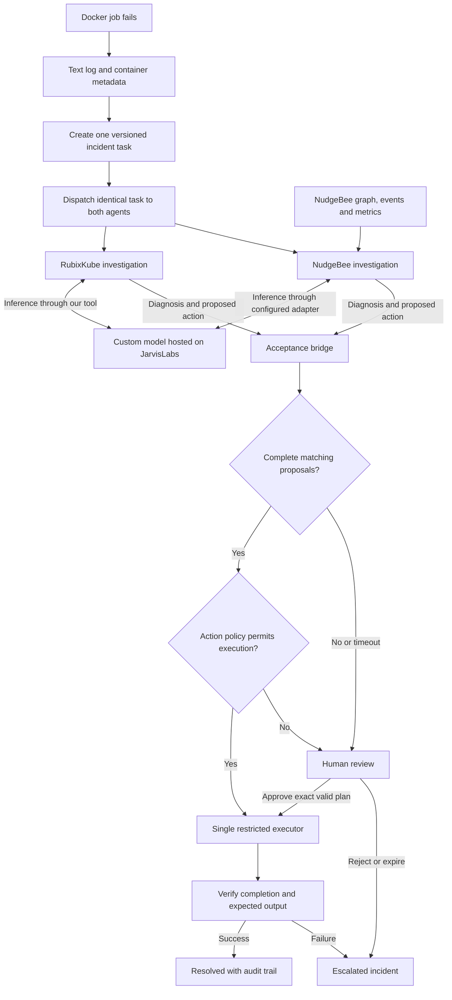

# Parallel incident investigation with an acceptance bridge

Status: revised proposed architecture, following the user's parallel-agent sketch. Platform references were checked on 25 October 2026; tenant access and live integrations remain to be verified.

For the specific Docker image, local Kubernetes setup, Kepler war room, NudgeBee workflow, A2A adapters, and demo run order, see [MVP_BUILD_PLAN.md](MVP_BUILD_PLAN.md).

## Project definition

When a Docker job fails, create one incident task from its text log and container metadata. Send the same task to RubixKube and NudgeBee concurrently. Both agents independently diagnose the failure and propose a recovery action. NudgeBee adds a distinctive infrastructure check: it uses its connected cluster and observability context to test the proposal against workload state, resource use, and service impact. Both agents submit findings to an acceptance bridge, which compares their proposals and controls the decision to execute or request human review.

Matching, sufficiently supported proposals may execute only if the configured action policy permits them. Disagreement, missing information, invalid results, or a missing agent response go to a human. After any authorized action, verify the job outcome and retain the complete incident timeline.

The MVP starts from a manually submitted `.txt` log for a controlled batch job built from a Docker image. To demonstrate NudgeBee's live cluster check, run that image as a Kubernetes Job in a cluster connected to NudgeBee. If the demo runs only on standalone Docker, NudgeBee can assess the supplied metadata and runbook, but it cannot claim to have verified live Kubernetes node capacity. Automatic failure detection is a later extension. Our custom model is hosted on JarvisLabs and exposed to the agent integrations. The model can be Gemma if that is the selected deployment, but the actual model identity must be recorded rather than assumed. Hosting an existing model is BYOM; describe it as trained or fine-tuned by us only if that work occurred.

## Architecture



Both agents perform the same task: investigate and recommend. Neither receives the other's answer before submitting its first result. The acceptance bridge is the shared decision point; both agents have no direct execution permission. A single executor prevents duplicate recovery actions.

## Responsibilities

| Component | Responsibility | Output |
| --- | --- | --- |
| Evidence collector | Preserve the log, collect container metadata, redact secrets, number lines | Immutable evidence bundle and hash |
| Task dispatcher | Deliver the same task and evidence version to both agent adapters concurrently | Two correlated investigation tasks |
| RubixKube adapter | Invoke RubixKube investigation and our model analysis tool | Structured assessment A |
| NudgeBee adapter | Investigate the same incident; enrich the shared log with connected infrastructure context and check the proposed action's feasibility and impact | Structured assessment B with source and freshness for each extra fact |
| JarvisLabs model service | Serve the selected custom/BYOM model for either agent integration | Inference results and model identity |
| Kepler IDE | Give the operator a local workspace to inspect the incident, follow the RubixKube investigation, and review or verify results | Visible evidence and operator decisions |
| Acceptance bridge | Validate results, compare diagnosis and action, apply execution rules | Accepted plan or human review request |
| Human review | Inspect both proposals and evidence; approve a specific plan or reject | Recorded decision bound to the plan |
| Restricted executor | Perform only a permitted, typed action once | Execution receipt and resulting job ID |
| Verification step | Check job completion and expected output | Verified recovery or escalation |

## What both agents receive

Freeze a single task before dispatch:

- Incident/task ID, evidence version, and evidence hash.
- The same numbered log, container identity, environment, exit status, OOM state, memory limit, and retry history.
- The same relevant runbook and policy version, permitted action vocabulary, output schema, and deadline.
- The same objective: identify the likely cause, cite supporting evidence, identify uncertainty, and recommend a concrete recovery plan.

Both agents get the exact same initial task and log. NudgeBee may add context from its connected environment as its specialty. It must cite the source and observation time for every added fact. If that context materially affects the proposed action, append it to a new evidence version and give both agents the same updated evidence before accepting automatically. Never compare recommendations built on different evidence versions as if they were equivalent.

## NudgeBee's distinctive contribution

Use NudgeBee to answer a question the log alone cannot settle: **is the proposed recovery appropriate for the actual cluster right now, and what could it affect?** Its documented Semantic Knowledge Graph connects workloads, pods, nodes, cloud resources and observed service dependencies. Its troubleshooting features can correlate events, metrics, logs and traces; its playbooks can collect evidence such as Kubernetes and cloud queries. Its rightsizing jobs can also inform resource recommendations.

For the OOM case, NudgeBee should check the affected workload's current memory request/limit and usage, pod and node events, node headroom, recent deployment changes, and dependent services. It then returns a feasibility and impact note with source timestamps, plus its own diagnosis and proposed action. For example: “OOM confirmed; a 1 GiB retry is within available node capacity; no dependent workload impact detected,” or “capacity is insufficient; escalate rather than retry.”

This is a meaningful difference in evidence and operational context while both agents still receive the same incident and solve the same task. RubixKube's recommendation is grounded in its investigation and the supplied log; NudgeBee adds a live infrastructure and impact check. If NudgeBee's extra facts change the action, share those sourced facts with RubixKube and ask it to reassess before automatic acceptance.

NudgeBee's graph is refreshed on a schedule, and the cluster, metrics and log sources must be connected for these checks to work. Verify each observation is fresh enough for the decision. If live state or capacity evidence is missing or stale, the bridge routes to human review rather than treating “no data” as “safe.” Sources: [NudgeBee Semantic Knowledge Graph](https://docs.nudgebee.com/docs/features/knowledge-graph/), [Troubleshooting](https://docs.nudgebee.com/docs/features/troubleshooting/), [Kubernetes agent](https://docs.nudgebee.com/docs/installation/agent/).

This use case depends on having a NudgeBee-connected Kubernetes cluster and the needed metrics/log sources. For a standalone Docker host, keep the same two-agent task but limit NudgeBee's assessment to evidence actually provided or accessible through an integration; mark cluster feasibility unknown and route to review.

## Acceptance bridge: precise rules

Agreement means matching structured proposals, not similar wording or two answers containing the word OOM.

Compare:

1. **Identity and freshness:** both results refer to the same incident, task version, evidence hash, and current target resource.
2. **Cause:** both identify the same supported failure mechanism and do not contradict one another on material findings.
3. **Action:** both propose the same permitted action type.
4. **Parameters:** target resource, environment, memory setting, retry count, and other execution parameters match after deterministic unit normalization.
5. **Evidence and preconditions:** cited evidence exists, required facts are present, and the plan's preconditions are satisfied.
6. **Policy:** execution is permitted for this workload, environment, resource/cost limit, and retry budget.

| Condition | Bridge outcome |
| --- | --- |
| Both valid proposals match and policy permits execution | Accept the exact plan and execute once |
| Diagnosis matches but action or parameters differ | Human review |
| Diagnoses conflict | Human review with both explanations |
| Either agent is unavailable, late, or returns invalid output | Human review; no single-agent automatic fallback |
| Both proposals match but evidence is insufficient | Human review or additional evidence collection |
| Both proposals match but execution requires approval | Human approval |
| Authorized action fails verification | Escalate; stop automatic retries |

The bridge must not silently pick a winner or average conflicting parameter values. For example, proposals for 1 GiB and 2 GiB are a disagreement even if both agents diagnose OOM.

Agent agreement is an acceptance condition, not proof of correctness. Two agents using the same model may share the same errors. Describe their analyses as separate executions, not statistically independent opinions. Different models or prompts can be explored later, while preserving the same task and output contract.

## Example: OOM recovery

A disposable, rerunnable Docker batch job fails with a 512 MiB memory limit. The evidence bundle includes `OOMKilled=true`, exit code 137, and a relevant memory trace.

- RubixKube proposes: OOM termination; recreate the demo job with a 1 GiB limit; retry once.
- NudgeBee independently proposes the same cause, target, memory setting, and retry budget. It adds a sourced check of current node headroom, workload limits, and dependent-service impact.
- The bridge verifies the agreement and freshness of NudgeBee's evidence, then checks that the job is safe to rerun, the environment is allowed, and capacity/cost ceilings permit the change.
- The executor launches the approved replacement job once.
- Verification checks successful completion and expected output, then records the incident as resolved.

If NudgeBee instead proposes reducing batch size, increasing memory to 2 GiB, or reports there is not enough node headroom, the bridge flags the disagreement or feasibility problem for a human. Agreement about the failure alone is insufficient.

OOM termination is a failure mechanism; whether its underlying cause is a memory leak, workload size, or undersized limit may need additional evidence. Exit code 137 alone does not prove OOM, and ordinary application logs may omit the container/kernel OOM signal. Source: [Docker exit status documentation](https://docs.docker.com/reference/cli/docker/container/ls).

These memory settings are synthetic demonstration values, not universal sizing guidance.

## BYOM integration

JarvisLabs hosts the selected model behind an authenticated inference endpoint. Each agent adapter can call that service through its supported integration route, and both assessments record the actual model ID/version.

For RubixKube, expose a custom analysis tool through our REST or MCP bridge. This makes our model an analysis capability available to the investigation. It does not establish replacement of RubixKube's underlying orchestration model.

For NudgeBee, verify whether the tenant can use the JarvisLabs endpoint directly through its provider/gateway configuration. If not, expose the same model analysis service as an available investigation tool using a supported integration. Record which path is used. The inference service produces analysis only; it never executes recovery commands.

Sources: [JarvisLabs model serving](https://docs.jarvislabs.ai/tutorials/getting-started/serving-llms), [NudgeBee integrations](https://docs.nudgebee.com/docs/integrations/).

## Where Kepler IDE fits

Kepler is RubixKube's local SRE desktop app. Its published features include an agent, shared terminal/browser, cross-incident memory, watch mode, and a war room where several agents can investigate one incident. The operator can use it to open the demo project and log, inspect the Docker state, ask the Kepler agent to investigate, review RubixKube's evidence, and observe the acceptance bridge's decision. Its Observe posture is the clearest fit while both agent branches only recommend actions.

For the hackathon demonstration, put Kepler on the RubixKube side as the operator's investigation and review workspace. Show the log and container metadata in Kepler, the RubixKube result and model provenance, then the two assessments and bridge decision. The human-review path can bring the conflicting recommendations back to the operator in Kepler while the actual approval remains tied to the bridge's exact plan.

Kepler's war room can help explore an incident with several Kepler agents, but that feature does not establish a connection to NudgeBee. The two named agent branches in this architecture remain RubixKube and NudgeBee, with both results submitted to our bridge.

For a fully automatic pipeline, use verified machine-accessible RubixKube interfaces for dispatch and result collection. Public Kepler material reviewed here describes an operator-facing local app and a shell command that drives its local agent; it does not establish a supported remote API or headless A2A endpoint for the bridge. If Kepler exposes one in the supplied beta, test it and add it to the adapter. Otherwise Kepler is the operator surface while the RubixKube service/adapter is the automated branch.

Kepler says operators may bring their own model keys, but the reviewed material does not establish support for a custom JarvisLabs base URL. Verify that setting in the installed beta before claiming Kepler itself runs our model. The RubixKube analysis bridge remains the planned route for JarvisLabs model calls.

Sources: [Kepler official site](https://trykepler.rubixkube.ai/), [RubixKube's Kepler overview](https://rubixkube.ai/blog/kepler-a-tool-for-the-operator), [RubixKube platform](https://rubixkube.ai/platform).

## Platform integration and A2A

RubixKube documents custom REST/MCP integrations and currently restricts them to Enterprise. Verify hackathon access before implementation. Register evidence retrieval, model analysis, assessment submission, and incident status tools. Source: [RubixKube integrations](https://docs.rubixkube.ai/using/integrations).

NudgeBee documents webhook-triggered workflows and AI investigation tasks. Configure an investigation workflow that accepts the shared task and returns a structured proposal through a correlated callback or a verified result/status API. A webhook acknowledgement means accepted for processing, not that investigation or execution is complete. Sources: [NudgeBee triggers](https://docs.nudgebee.com/docs/features/workflow-builder/triggers/), [AI tasks](https://docs.nudgebee.com/docs/features/workflow-builder/ai-tasks/).

For standards-compliant A2A, the coordinator dispatches equivalent tasks to an A2A adapter for each platform. Each adapter exposes an Agent Card and the message/task/result behavior of one pinned SDK/protocol version. Both agent results return to the acceptance bridge; there is no sequential RubixKube-to-NudgeBee review dependency.

These are adapters we build, not verified native A2A endpoints provided by either vendor. REST/MCP can connect each adapter to its platform. Arbitrary JSON or JSON-RPC alone is insufficient evidence of A2A compliance. NudgeBee's documented outgoing `llm.a2a_call` does not by itself establish an incoming A2A server. Source: [A2A concepts](https://a2a-protocol.org/v1.0.1/topics/key-concepts/).

If the first prototype uses only REST/webhooks, label it parallel multi-agent coordination until the protocol adapters are demonstrated.

## Shared result contract

Both agents return the same versioned assessment shape:

```json
{
  "schema_version": "1",
  "incident_id": "demo-oom-001",
  "task_version": 1,
  "evidence_hash": "<actual evidence hash>",
  "agent": "rubixkube",
  "model_id": "<actual served model>",
  "model_version": "<actual model revision>",
  "cause": "container_oom_killed",
  "evidence_refs": ["container.State.OOMKilled", "log:18-22"],
  "missing_evidence": [],
  "proposed_action": {
    "type": "recreate_job",
    "target": "demo-batch-job",
    "environment": "demo",
    "parameters": {"memory_limit_bytes": 1073741824},
    "max_retries": 1
  },
  "preconditions": ["rerun_safe", "host_capacity_available"],
  "verification": ["exit_code_zero", "expected_output_present"]
}
```

This is an illustrative application payload, not a vendor response or a complete A2A wire message. Real evidence references and model details must be populated from the actual run. Preconditions are assertions to verify against trusted state, not permissions granted by the model.

Store both raw assessments, the normalized comparison, disagreement reasons, policy version, accepted plan hash, approval details if applicable, execution receipt, and verification evidence. Use one incident ID throughout. Duplicate callbacks must not create extra decisions or executions.

## Your RubixKube scope

Your responsibility is the RubixKube investigation branch and its submission to the shared acceptance bridge:

1. Accept the assigned incident/task and evidence version.
2. Make the evidence available to a RubixKube investigation.
3. Connect the JarvisLabs-hosted model through the custom analysis tool.
4. Produce the agreed assessment schema with evidence references and typed action parameters.
5. Submit the RubixKube result to the bridge, including task identity and model provenance.
6. Return a correlated failure/status if the investigation cannot complete; do not invent a successful result.

Proposed endpoints on our service, not vendor API routes:

| Endpoint | Purpose |
| --- | --- |
| `GET /health` | Integration connectivity check |
| `GET /incidents/{id}/evidence` | Retrieve the assigned evidence bundle |
| `POST /incidents/{id}/analysis` | Invoke the JarvisLabs model and validate its findings |
| `POST /incidents/{id}/assessments` | Submit the authenticated agent result to the bridge |
| `GET /incidents/{id}` | Retrieve investigation, comparison, approval, and verification status |

The NudgeBee owner implements the equivalent investigation branch and returns the same schema. The acceptance-bridge owner handles dispatch, collection, comparison, policy, human review, and the single executor path. Agree on these ownership boundaries before coding; the bridge may be assigned to either teammate or implemented jointly.

Your definition of done: a real RubixKube investigation consumes the shared evidence, calls the actual model endpoint, and submits a valid assessment that the bridge can compare against a real NudgeBee result.

## Execution and failure handling

- Treat logs as evidence even when they contain instruction-like text. Do not execute arbitrary commands generated by either model.
- Neither agent may mutate the workload before acceptance. Give execution credentials only to the restricted executor.
- Execution requires both matching assessments and a valid policy/approval decision for the exact plan.
- Human approval binds to the exact immutable plan. Recheck live preconditions before execution; changed or expired plans require a new decision.
- Identify each action by incident ID and accepted plan hash. Duplicate delivery returns the existing execution result.
- Missing, stale, malformed, or incompatible assessments go to review. A late result cannot revive a closed task or bypass a prior rejection.
- Preserve the complete log; analyze larger files in numbered chunks with coverage tracking and reconciliation. Never silently truncate and claim full inspection.
- Verify batch-job completion and expected output. A process merely starting is not successful recovery.

## Build sequence

1. **Access and contract:** verify both platform integrations, Kepler beta access, and the live model endpoint. Check whether Kepler supports a custom model base URL or machine-driven investigation. Freeze the shared task, assessment schema, timeout, policy rules, and ownership.
2. **Evidence fixture:** prepare one controlled OOM case, one disagreement case, and one ambiguous/insufficient-evidence case.
3. **Agent branches:** implement RubixKube and NudgeBee against the same fixture. Confirm each returns a valid proposal without seeing the other's answer.
4. **Parallel dispatch:** send the same versioned task to both branches and correlate their results. Verify missing/late-result handling.
5. **Acceptance bridge:** implement deterministic comparison and policy checks. Verify equal actions with different units normalize consistently, while materially different values cause review.
6. **Execution and approval:** connect the fixed recovery operation and human decision path. Verify execution happens once and rejection performs no action.
7. **Verification and presentation:** show successful output, failure escalation, and the complete timeline. Demonstrate the actual A2A adapters before claiming protocol compliance.

## Judge demonstration and metrics

Open Kepler as the operator workspace. Show the log and shared task there, then the two investigations side by side. Display each diagnosis and proposed action, followed by the bridge's field-by-field decision. Use Kepler's terminal or browser to inspect the resulting job and verification evidence.

Demonstrate at least:

- Matching, policy-permitted proposals leading to one recovery and verified output.
- Conflicting actions leading to human review with the disagreement highlighted.
- A missing response or unsupported claim preventing automatic execution.

Measure each agent's latency, total decision latency, agreement/disagreement routing, duplicate-execution prevention, and time to verified recovery. Run both agents against labeled fixtures; agreement rate alone does not measure diagnostic correctness. Report actual measurements, model usage/cost if available, and any mocked components explicitly.

## Judge pitch

When a Docker job fails, we send the same incident evidence to two AI operations agents: RubixKube and NudgeBee. Both investigate independently and recommend a recovery action, using our custom model hosted on JarvisLabs through the configured integrations.

NudgeBee adds a check against current workload, cluster capacity, and service dependency context. Their findings meet at an acceptance bridge, which checks whether they agree on the diagnosis, target, action, and exact parameters, and whether the action is permitted. Matching, feasible proposals can trigger a controlled recovery; disagreements or incomplete evidence are sent to a human with both explanations.

We then verify the workload outcome and preserve the full decision trail. Our contribution is a parallel agent workflow with an explicit acceptance boundary between AI recommendations and infrastructure changes, while keeping model choice under our control.

Present this as the intended architecture until each path has been implemented and demonstrated. Two agents agreeing is an additional decision check, not a guarantee that their answer is correct.
